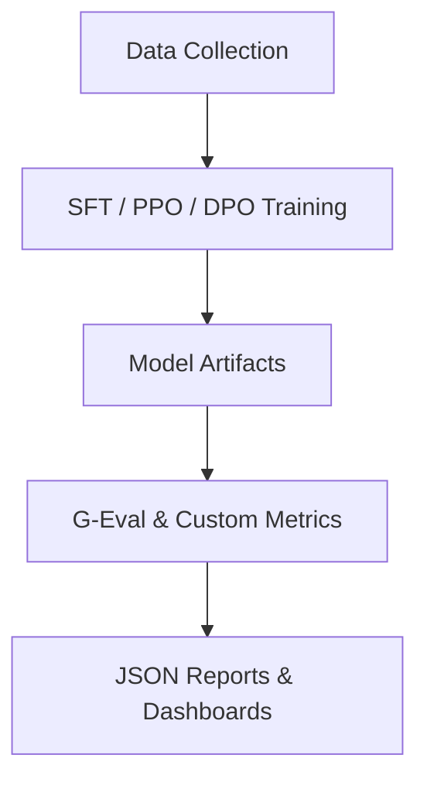

# SciGURU Backend 🚀

**Modular training, fine-tuning and evaluation pipeline for generating high-quality scientific explanations with Large Language Models (LLMs).**


<details>
<summary><strong>Table of Contents</strong></summary>

- [Project Overview](#project-overview)
- [Backend Directory Structure](#backend-directory-structure)
- [Pipeline Components](#pipeline-components)
- [Tools & Dependencies](#tools--dependencies)
- [Environment Setup](#environment-setup)
- [Running the Pipeline](#running-the-pipeline)
- [SLURM (HPC) Guide](#slurm-hpc-guide)
- [Output Files](#output-files)
- [Configuration](#configuration)
- [Credits](#credits)

</details>


---
</br>

## Project Overview

The backend orchestrates every research step required to transform raw scientific questions into **concise, audience-aware answers** and automatically evaluate their pedagogical quality.



---
</br>

## Backend Directory Structure

```text
Backend/
├── Code/
│   ├── Eval/               # Evaluation metrics & tests
│   │   ├── g_eval/         # G-Eval implementation (Zemla, quality metrics)
│   │   └── Jargon/         # Custom jargon metric
│   └── Train/
│       ├── SFT/            # Supervised fine-tuning
│       ├── PPO/            # Policy-gradient optimisation
│       ├── DPO/            # Direct Preference Optimisation
│       └── RLVR/           # Reward-learning via RL-based value ranking
│
├── Utils/                  # Helper scripts (data extraction, evaluation)
├── Scripts/                # SLURM jobs & environment bootstrap
├── Log/                    # Cluster log outputs
└── ReadMe.md               # ← this file
```

---
</br>

## Pipeline Components

1. **Model Loading & Preparation**  
   Loads base LLMs (default ⟶ Llama-3 8B) with 4-bit/8-bit quantisation, sets padding & LoRA adapters.

2. **Training Data Preparation**  
   Converts `training_data.json` into DPO triplets (prompt, chosen, rejected).

3. **Fine-Tuning**  
   - **SFT** → supervised initialisation.  
   - **PPO** → policy improvement with reward model.  
   - **DPO** → memory-efficient preference optimisation.

4. **Response Generation**  
   Batched inference for scientific Q&A datasets.

5. **Evaluation**  
   Comprehensive **G-Eval** suite:
   - *Zemla metrics* (coherence, completeness, etc.)
   - *Explanation Quality* (analogy, audience connection, etc.)
   - *Jargon metric* (lexical accessibility)
   
6. **Reporting**  
   Produces `evaluation_report.json` per answer + summary statistics.

---
</br>

## Tools & Dependencies

| Category | Stack |
| -------- | ----- |
|  ML / DL | PyTorch, Transformers, PEFT, BitsAndBytes |
|  Training | datasets, tqdm, numpy, psutil |
|  Evaluation | deepeval, pandas, colorama |
|  Ops | python-dotenv, bash, SLURM |

Install all dependencies via:

```bash
pip install -r Backend/requirements.txt
```

---
</br>

## Environment Setup

```bash
# 1 – Clone repository
$ git clone https://github.com/golyuval/SciGURU.git && cd SciGURU

# 2 – Create & activate clean virtualenv
$ ./Backend/Scripts/reset_env.sh      # builds ./my_env & installs core deps
$ source my_env/bin/activate

# 3 – Additional dependencies (optional)
$ pip install transformers torch bitsandbytes peft datasets

# 4 – Configure secrets (.env)
OPENAI_API_KEY=your_openai_api_key
HF_READ_TOKEN=your_hf_read_token
HF_WRITE_TOKEN=your_hf_write_token
```

---
</br>

## Running the Pipeline

### Quick G-Eval smoke test

```bash
python Backend/Code/Eval/g_eval/test_g_eval.py
```

### Fine-tune with DPO (CPU/GPU)

```bash
python Backend/Code/Train/DPO/train_model.py \
  --epochs 2 --batch_size 1 --beta 0.1
```

### Evaluate preference data

```bash
python Backend/Utils/evaluate_preference_data.py \
  --input Backend/Utils/preference_data.json
```

---
</br>

## SLURM (HPC) Guide

The `Backend/Scripts/Train` folder includes ready-to-run `sbatch` files.

```bash
sbatch Scripts/Train/load_data.sbatch   # download datasets to SFT/datasets
sbatch Scripts/Train/SFT.sbatch         # run SFT on RTX 4090 partition
sbatch Scripts/Train/SFT_.sbatch        # run SFT on RTX 3090 partition
```

Logs are streamed to `Backend/Log/Cluster/<job_id>.out`.


---
</br>


## Credits

- **Research Lead :** Professor Nir Grinberg  
- **Research Associate :** Mattan Yeroushalmi  
- **Research Assistants :** Yuval Goldstein, Evyatar Kopans, Peleg Ben Barak


